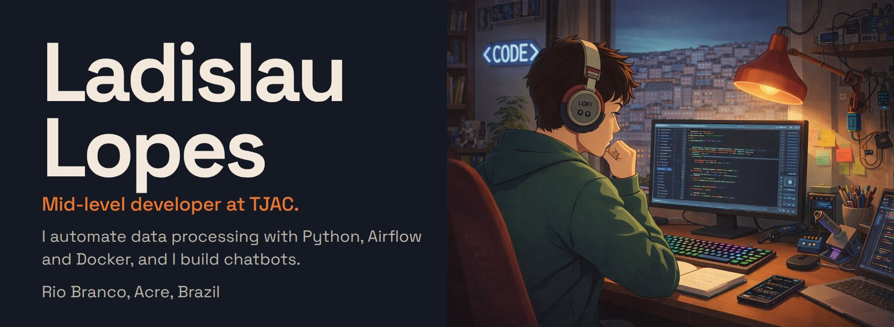
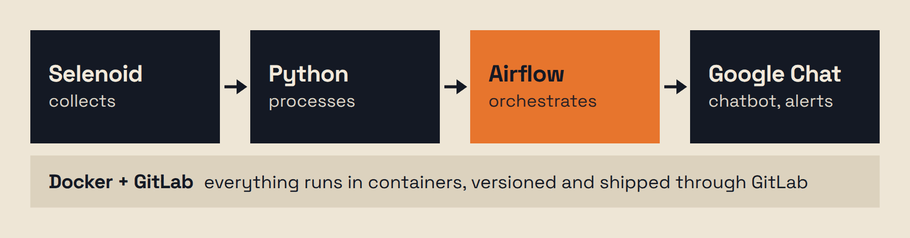
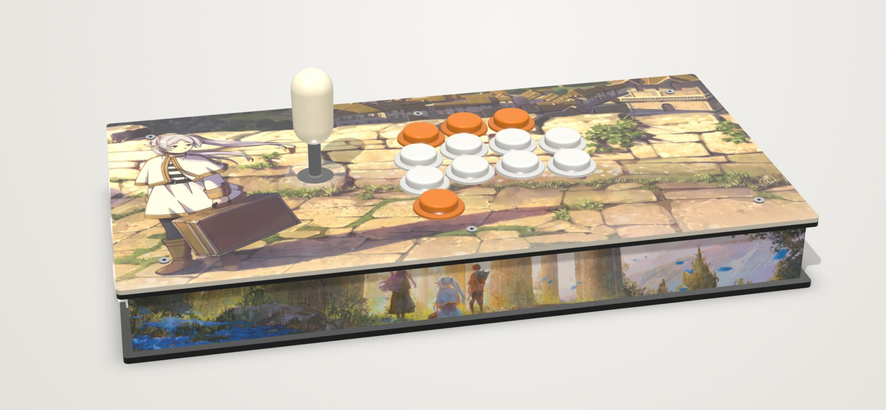

<a href="./readme.md">Português</a> · <b>English</b> · <a href="./README-es.md">Español</a>

<a href="https://www.linkedin.com/in/ladislaulopes/"><b>LinkedIn</b></a> · <a href="https://www.instagram.com/ladslopes/"><b>Instagram</b></a>

## What I do at TJAC

Since May 2024 I've been a mid-level developer at the Court of Justice of the State of Acre, Brazil. I automate data processing (I can't say which data), design the architecture these automations run on, and build chatbots that notify and answer the team on Google Chat.

## Arcade Builder

A browser-based editor for planning the artwork of an arcade controller before having it made. Pick the case and layout, upload your art and see the controller assembled in 3D, with the button, stick and screw holes in the right place. I started it because I was about to order my own and didn't want to print blind; the one in the picture is mine.

- 9 case models and 37 layouts, plus a check that the lever fits the side height
- Artwork, text and logos dragged straight onto the 3D model, and Sanwa button colors suggested from the art itself
- Exports 300 DPI PNGs for printing, DXF and SVG panels for laser cutting, a turntable video and the order text
- A single HTML file with no server: three.js, JSZip, MediaRecorder and IndexedDB, and your images never leave your computer

**[Try Arcade Builder in your browser →](https://arcade-config.pages.dev/)**

## Experience

| | Organization | Period |
|:-:|---|---|
|  | **Court of Justice of the State of Acre (TJAC)** Mid-level developer | May 2024 – present |
|  | **Brazilian Federal Police** · [letter of recommendation](https://drive.google.com/file/d/1USAiIS-lYw2fcdw0B1r2d661BG39Q-qp/view?usp=sharing) | Feb 2023 – May 2024 |

## Tools

Python, JavaScript, HTML and CSS, Git and GitLab, Docker, Apache Airflow, Selenium and Selenoid, Google Chat, three.js and Blender.

Currently learning: TypeScript, NestJS and FastAPI.

 

