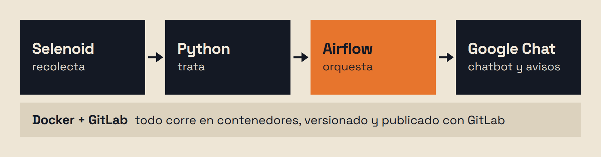

<a href="./readme.md">Português</a> · <a href="./README-en.md">English</a> · <b>Español</b>

<a href="https://www.linkedin.com/in/ladislaulopes/"><b>LinkedIn</b></a> · <a href="https://www.instagram.com/ladslopes/"><b>Instagram</b></a>

## Qué hago en el TJAC

Desde mayo de 2024 soy desarrollador semi-senior en el Tribunal de Justicia del Estado de Acre, Brasil. Automatizo el tratamiento de datos (no puedo contar cuáles), diseño la arquitectura en la que corren esas automatizaciones y desarrollo chatbots que avisan y responden al equipo por Google Chat.

## Arcade Builder

Un editor que funciona en el navegador para planificar el arte de un control arcade antes de mandarlo a fabricar. Eliges la caja y el layout, subes tus artes y ves el control montado en 3D, con los agujeros de los botones, del stick y de los tornillos en su lugar. Lo empecé porque iba a encargar el mío y no quería imprimir a ciegas; el de la imagen es ese.

- 9 modelos de caja y 37 layouts, con verificación de que la palanca cabe en la altura del lateral
- Arte, texto y logo arrastrados directamente sobre el 3D, y colores de botones Sanwa sugeridos a partir del propio arte
- Exporta PNG en 300 DPI para imprenta, placas en DXF y SVG para corte láser, un video del control girando y el texto del pedido
- Un único archivo HTML, sin servidor: three.js, JSZip, MediaRecorder e IndexedDB, y tus imágenes no salen de tu computadora

**[Probar Arcade Builder en el navegador →](https://arcade-config.pages.dev/)**

## Trayectoria

| | Institución | Período |
|:-:|---|---|
|  | **Tribunal de Justicia del Estado de Acre (TJAC)** Desarrollador semi-senior | may/2024 – actualidad |
|  | **Policía Federal de Brasil** · [carta de recomendación](https://drive.google.com/file/d/1USAiIS-lYw2fcdw0B1r2d661BG39Q-qp/view?usp=sharing) | feb/2023 – may/2024 |

## Herramientas

Python, JavaScript, HTML y CSS, Git y GitLab, Docker, Apache Airflow, Selenium y Selenoid, Google Chat, three.js y Blender.

Estudiando ahora: TypeScript, NestJS y FastAPI.

 

