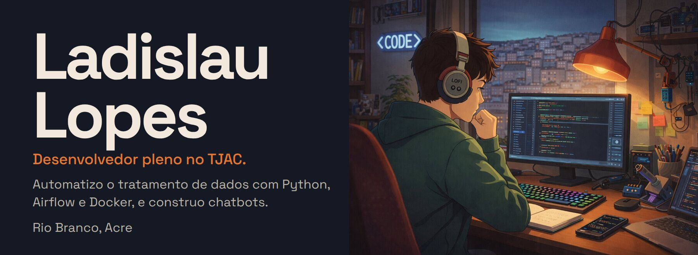
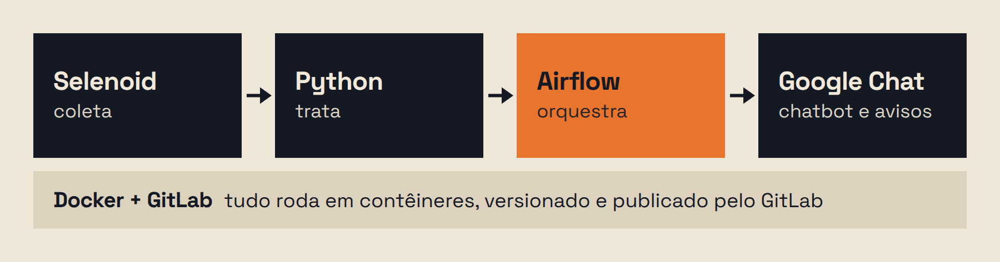

<b>Português</b> · <a href="./README-en.md">English</a> · <a href="./README-es.md">Español</a>

<a href="https://www.linkedin.com/in/ladislaulopes/"><b>LinkedIn</b></a> · <a href="https://www.instagram.com/ladslopes/"><b>Instagram</b></a>

## O que eu faço no TJAC

Desde maio de 2024 sou desenvolvedor pleno no Tribunal de Justiça do Estado do Acre. Automatizo o tratamento de dados (quais dados, não posso contar), desenho a arquitetura que roda essas automações e desenvolvo chatbots que avisam e respondem a equipe pelo Google Chat.

## Arcade Builder

Um editor que roda no navegador para planejar a arte de um controle arcade antes de mandar fabricar. Você escolhe a caixa e o layout, sobe as artes e vê o controle montado em 3D, com os furos dos botões, do stick e dos parafusos no lugar certo. Comecei porque ia encomendar o meu e não queria imprimir no escuro; o da imagem é ele.

- 9 modelos de caixa e 37 layouts, com checagem se a alavanca cabe na altura da lateral
- Arte, texto e logo arrastados direto no 3D, e cores de botões Sanwa sugeridas a partir da própria arte
- Exporta PNGs em 300 DPI para a gráfica, chapas em DXF e SVG para corte a laser, um vídeo do controle girando e o texto do pedido
- Um único arquivo HTML, sem servidor: three.js, JSZip, MediaRecorder e IndexedDB, e as imagens não saem do seu computador

**[Testar o Arcade Builder no navegador →](https://arcade-config.pages.dev/)**

## Trajetória

| | Instituição | Período |
|:-:|---|---|
|  | **Tribunal de Justiça do Estado do Acre (TJAC)** Desenvolvedor pleno | mai/2024 – atual |
|  | **Polícia Federal** · [carta de recomendação](https://drive.google.com/file/d/1USAiIS-lYw2fcdw0B1r2d661BG39Q-qp/view?usp=sharing) | fev/2023 – mai/2024 |

## Ferramentas

Python, JavaScript, HTML e CSS, Git e GitLab, Docker, Apache Airflow, Selenium e Selenoid, Google Chat, three.js e Blender.

Estudando agora: TypeScript, NestJS e FastAPI.

 

